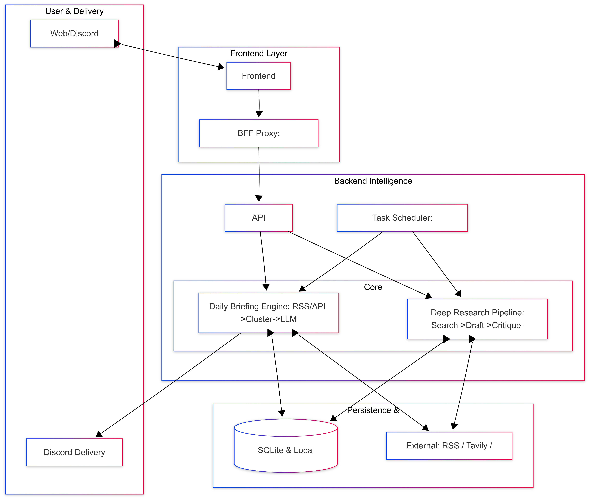
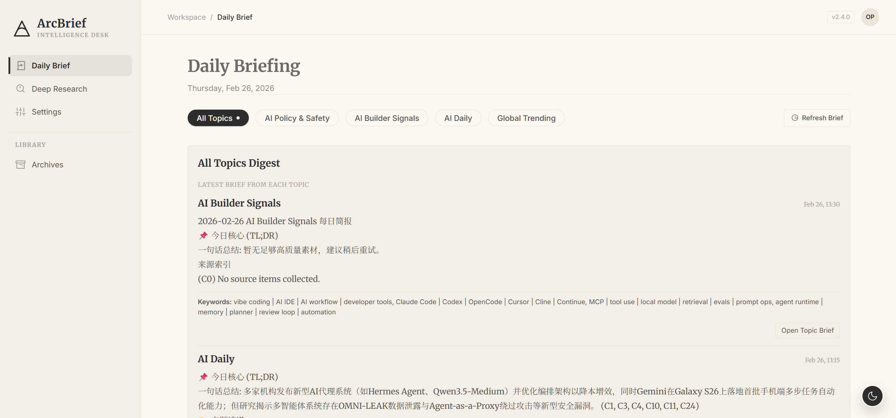
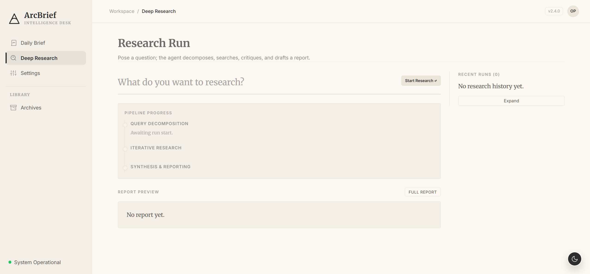
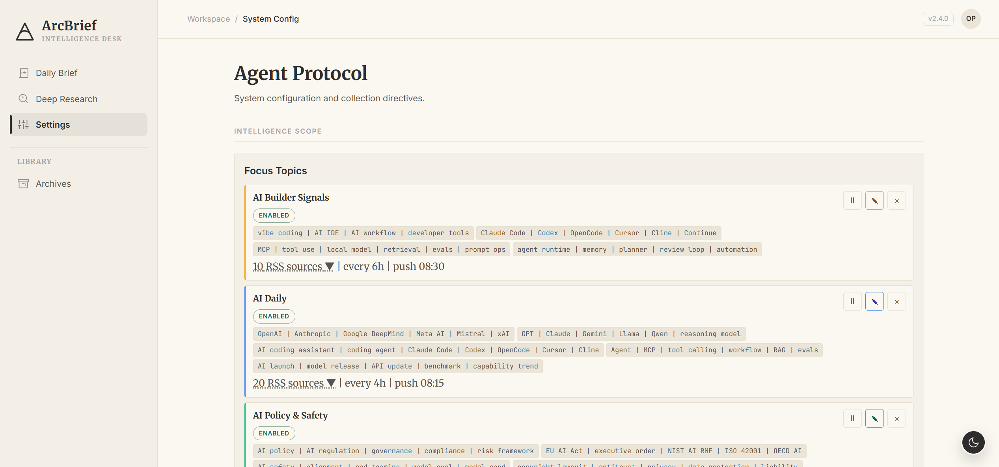
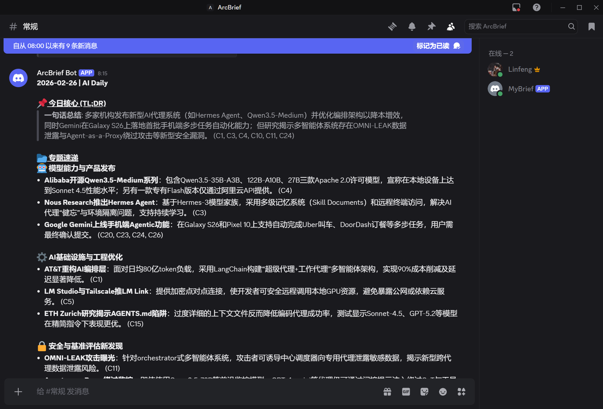

# ArcBrief

> Local-first AI intelligence workstation — continuous tracking meets deep research in one product loop.



ArcBrief is a deployable AI intelligence workstation with two core engines:
- **Daily Brief** — RSS collection, clustering, LLM synthesis, multi-channel push (Discord)
- **Deep Research** — multi-stage agent pipeline (Outline → Search → Summary → Host → Reflection → Formatting)

## Product Walkthrough

| Scene | Screenshot | Description |
|---|---|---|
| Daily Brief |  | Topic-grouped briefs with one-click refresh, citation tracking, and structured card rendering. |
| Deep Research |  | Multi-stage research flow with real-time progress, iterative search rounds, and full report preview. |
| Settings |  | Configure focus topics, keywords, search providers, LLM models, and push schedules. |
| Discord Push |  | Automated brief delivery to team channels — minimizing the gap between generation and consumption. |

## Technical Highlights

| Capability | Detail |
|---|---|
| Dual Engine | Daily Brief (breadth) + Deep Research (depth) in one product |
| Multi-Provider Search | Tavily, Bocha, Zhipu (GLM), Exa, plus Volcano Engine in degraded plain-chat compatibility mode until native web-search integration is added |
| Intelligence-Grade Prompts | First-principles analysis, cross-verification, confidence calibration, banned buzzword filtering |
| BFF Security Proxy | Frontend route classification (`public_get` / `guest_post` / `admin` / `forbidden`) — browser never sees backend keys |
| Multi-Language | English, Simplified Chinese, Japanese — all prompts, UI, and output |
| Observability | Search provider diagnostics, strict failure mode, per-request metadata |
| Export | One-click PDF export for briefs and research reports |
| Push | Discord bot with scheduled delivery |

## Architecture

```
Next.js 16 (App Router)          FastAPI Backend          SQLite
┌─────────────────┐       ┌─────────────────────┐    ┌──────────┐
│  BFF Proxy       │──────▶│  /api/brief          │───▶│  briefs  │
│  (classifyRoute) │       │  /api/research       │    │  reports │
│                  │       │  /api/topics          │    │  topics  │
│  MarkdownViewer  │       │  /api/settings        │    └──────────┘
│  ResearchPanel   │       │                       │
│  NewsFeedPanel   │       │  foreign_query_agent/ │
│  ArchivesPanel   │       │  ├── nodes/           │
└─────────────────┘       │  ├── prompts/         │
                           │  └── tools/           │
                           │      (factory.py)     │
                           └─────────────────────┘
```

## Quick Start

```bash
# Backend
pip install -r requirements.txt
cp .env.example .env          # fill in API keys
uvicorn backend.main:app --reload

# Frontend
cd frontend
npm install
npm run dev
```

## Discord Bot Guide

The Discord bot is optimized for quick mobile consumption. It favors short summaries over full markdown dumps.

### Commands

- `/topics`
  - List all configured topics with `id | name` and active/paused status.
- `/brief topic:<id-or-name>`
  - Get the latest saved brief for a topic.
  - Accepts either a numeric topic id like `3` or a topic name fragment like `ai daily`.
  - The response now includes `Brief ID`, which is the value used by `/save`.
- `/digest`
  - Show the latest brief summary for each topic in one compact list.
  - Each digest line now includes the `brief_id`.
- `/ask question:<text> topic?:<optional>`
  - Ask a question against ArcBrief context.
  - The bot will label which context layer answered the question:
    - `brief_context`
    - `article_context`
    - `ingestion_context`
    - `web_fallback`
- `/tldr url:<public-url>`
  - Fetch a public article page and summarize it.
  - Repeated requests for the same URL use the cached ingestion record.
- `/research query:<text>`
  - Start a background deep-research run.
  - The bot polls for up to about 6 minutes, then falls back to a “still running in the background” status message if the report is not ready yet.
- `/analyze product:<text>`
  - Start a background PM-style analysis run.
  - This uses the same long-running pipeline as `/research`, but rewrites the result into a product/company analysis structure.
- `/save brief_id:<id> note?:<optional>`
  - Save an existing brief for later review.
  - A brief does not need to be from “today”; any stored `brief_id` can be saved.
- `/saved`
  - List your saved briefs.
- `/unsave brief_id:<id>`
  - Remove a saved brief.

### Synchronous vs background commands

- Synchronous: `/topics`, `/brief`, `/digest`, `/ask`, `/tldr`, `/save`, `/saved`, `/unsave`
- Background tasks with polling: `/research`, `/analyze`

### Concurrency limits

- Research/analysis pool:
  - `/research` and `/analyze` share the same backend pool.
  - Default limit: `MAX_CONCURRENT_RESEARCH=3`
- Chat pool:
  - `/ask` uses a separate pool.
  - Default limit: `MAX_CONCURRENT_CHAT=10`

### Model and search-provider behavior

- `/research` and `/analyze`
  - Use the primary model configured in app config: `primary_model`
- `/ask` and `/tldr`
  - Currently use the one-shot LLM path driven by `FQ_LLM_MODEL`
- Search provider
  - Controlled by backend app config: `search_provider`
  - Discord does not expose model/provider switching in this phase; change it in the web UI or backend config

### Known limits

- `/tldr` can fail on sites that block server-side fetches, for example via `403 Forbidden`
- `/save` depends on a visible `brief_id`; use the ids shown in `/brief`, `/digest`, or `/saved`
- If `/research` or `/analyze` exceed the bot’s polling window, the backend job may still continue and finish later
- `/brief` returns the latest saved brief currently in the database for that topic
- If `/brief` or `/digest` appear empty in the morning, first verify the deployed backend is using the expected persistent volume and still has the previous day’s SQLite data

## Portfolio Report

- Product Case (Markdown): `docs/portfolio/arcbrief-product-case.md`
- Product Case (PDF): `docs/portfolio/ArcBrief_Product_Case_PM.pdf`
